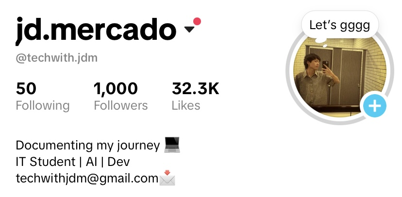

# Upskill in Public

A free learning kit for CS/IT (Computer Science / Information Technology) students who want to showcase their skills in public.

## Why this exists

This kit is a thank you for reaching 1000+ followers on TikTok. It gives you a place to start, practice, and show your progress one small step at a time.

## Who it is for

Students and self-learners exploring software development, cloud engineering, and future paths are welcome. The planning and note templates work for any CS/IT goal.

## Start in 3 steps

1. Read [Getting Started](GETTING-STARTED.md) to get your own copy. A repository, or repo, is a folder of files hosted on GitHub.
2. Pick one learning path in the [path index](paths/README.md).
3. Use the [templates](templates/README.md) and your [my-learning folder](my-learning/README.md) to track and share your progress.

## What's inside

| Folder | What it contains |
| --- | --- |
| [.github/](.github/) | The form for suggesting a new path. |
| [start-here/](start-here/) | Help choosing a path, planning study time, and sharing progress. |
| [my-learning/](my-learning/) | Your own notes, logs, and projects in your copy. |
| [paths/](paths/) | Learning guides, roadmaps, and example folders. |
| [templates/](templates/) | Reusable pages for notes, daily logs, projects, and progress. |
| [resources/](resources/) | Links to free learning material. |

## Available paths

| Path | Status and details |
| --- | --- |
| Web development: foundations, frontend, backend | Available — [path index](paths/README.md) |
| Cloud engineering: Microsoft Azure / AZ-900 | Available — [path index](paths/README.md) |
| Mobile app development | Available — [path index](paths/README.md) |
| AWS / Cloud Practitioner (CLF-C02) | Available — [path index](paths/README.md) |
| Google Cloud / Cloud Digital Leader | Available — [path index](paths/README.md) |

## Updates and suggestions

This kit will be updated regularly with new paths, following foundations, checkpoints, and role-focused next steps. Detailed cloud role-based certification roadmaps and deeper role-focused projects are planned for future updates. New paths are announced on TikTok.

1. Open this repository's [Issues page](https://github.com/ctrl-jo/upskill-in-public/issues).
2. Select **New issue**, then **Suggest a path** (and **Get started** if shown).
3. Fill in the fields and select **Submit new issue**. A GitHub account is needed to send a suggestion.

## Thank you

Thank you for being part of this community. Your first small step counts, and I'm glad you're here.
